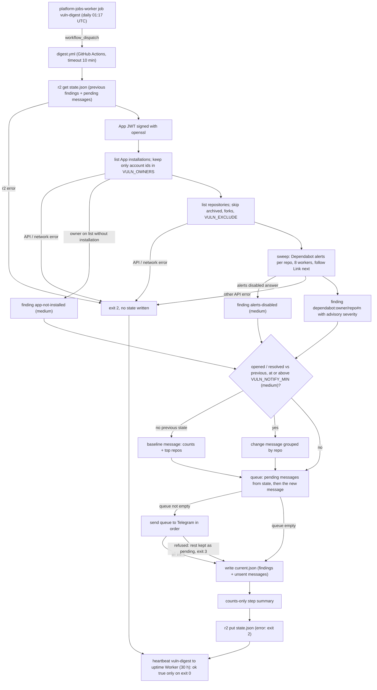
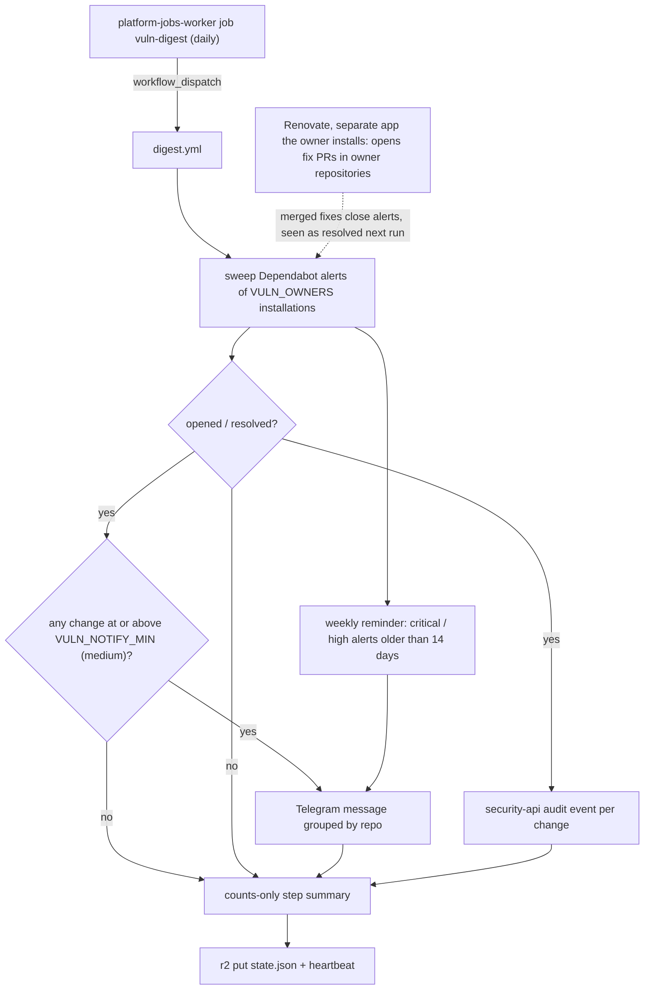

# 01 — Business process (As-Is / To-Be)

platform-vuln-digest คือ job รายวันที่อ่าน Dependabot alerts ที่เปิดอยู่ของทุก repository ของ owner ผ่าน GitHub App แบบอ่านอย่างเดียว เทียบกับรอบก่อน แล้วส่ง Telegram ให้ owner เฉพาะเมื่อมี alert เปิดหรือปิด (ถึงระดับ `VULN_NOTIFY_MIN`) หรือ repo ปิด alerts ไว้ รอบแรกที่ยังไม่มี state ส่งข้อความ baseline หนึ่งข้อความ

Last reviewed: 2026-11-28 · commit `41f91f8`

## As-Is (จากโค้ดวันนี้)

Sources: `.github/workflows/digest.yml`, `vuln_digest/run.py` (`live_findings`, `run`, `main`), `vuln_digest/github.py` (`parse_owners`, `app_jwt`, `http`), `vuln_digest/checks.py` (`sweep`, `WORKERS = 8`), `vuln_digest/report.py`, `vuln_digest/r2.py`, `README.md`

ข้อเท็จจริงจากโค้ด: ทุกรอบที่สแกนสำเร็จจะส่งข้อความค้าง (pending) จาก state ก่อนข้อความใหม่ แม้รอบนั้นไม่มี finding เปลี่ยน (`run.py` `run`); ข้อความ baseline ก็เข้าคิวส่ง Telegram เหมือนข้อความแจ้งการเปลี่ยนแปลง (`report.py` `message`, `first_run`); error ตอนอ่าน state, installations, repositories หรือ alerts ทำให้ exit 2 โดยไม่เขียน state และ heartbeat ส่ง `ok: false` (`digest.yml` ขั้น Digest และ Heartbeat)

ไม่มีโค้ดส่ง audit event ไป `security-api` และไม่มี reminder รายสัปดาห์ (ค้นใน `vuln_digest/` ไม่พบ); Renovate ไม่ได้อยู่ใน repo นี้

## To-Be (`docs/specs/001-vuln-digest.md` status accepted, §Later; `docs/adr/ADR-0001-dependabot-alerts-and-app.md`)

Sources: `docs/specs/001-vuln-digest.md` §Outcome, §Requirements R1–R7, §Later (audit event ผูกกับผล diff ไม่ใช่กับการส่ง Telegram จึงไม่เกิดในรอบที่มีแค่ reminder; Renovate เป็นกระบวนการแยก digest ยังรายงานอย่างเดียว)

## Gap

| ID | As-Is → To-Be | Status | Owner | Evidence |
|---|---|---|---|---|
| G1 | ไม่มีการเตือนซ้ำ alert เก่า → reminder รายสัปดาห์ของ critical / high ที่ค้างเกิน 14 วัน | todo | claude | spec §Later; ไม่พบใน `vuln_digest/` |
| G2 | ไม่มี audit event ต่อการเปลี่ยนแปลง → `security-api` audit event ต่อ finding ที่เปิด / ปิด (แบบ posture-monitor) | todo | claude | spec §Scope "Out of scope for v1", §Later |
| G3 | digest รายงานอย่างเดียว ไม่มีใครเปิด fix PR → Renovate เปิด PR แก้ (owner ตัดสิน 2026-11-28: ใช้ Renovate). 2026-11-28 ยังไม่ยืนยันว่าติดตั้ง app แล้วหรือยัง (ไม่พบ PR จาก `renovate[bot]` ใน owner `bookchaowalit` แต่ข้อนี้ไม่ใช่หลักฐานว่ายังไม่ติดตั้ง) → owner ดูที่ https://github.com/settings/installations ถ้ายังไม่มีให้ติดตั้งที่ https://github.com/apps/renovate | todo | owner | spec §Later; spec §Problem "Renovate is not installed" [ต้องยืนยัน] สถานะวันนี้ |
| G4 | ถ้า App ติดตั้งแบบเลือกบาง repo ระบบสแกนเฉพาะที่ `/installation/repositories` คืนมา และ `app_not_installed` ยังเป็น 0 → ระบุขอบเขตนี้ใน diagram และรายงานจำนวน repo ที่ไม่ได้สแกน (Codex review 2026-11-28, จดไว้แทนการวาดใหม่ตามที่ owner สั่ง) | todo | claude | `vuln_digest/github.py:109-120` |
| G5 | diagram ไม่มีทางสำหรับรอบที่สแกนสำเร็จแต่ไม่พบ finding ทั้งที่ยังเทียบ state เดิมและแจ้ง finding ที่ปิดไป → เพิ่มทางนี้ (Codex review 2026-11-28, จดไว้แทนการวาดใหม่ตามที่ owner สั่ง) | todo | claude | `vuln_digest/run.py:43-66` |
| G6 | To-Be ส่ง reminder ทุกการสแกนรายวันโดยไม่มีเงื่อนไขรอบสัปดาห์ (P3) → แสดงเงื่อนไข (Codex review 2026-11-28, จดไว้แทนการวาดใหม่ตามที่ owner สั่ง) | todo | claude | To-Be diagram `SWEEP` → `OLD` → `TG` |

## Open questions

- ข้อ "Later" ใน spec ยังเป็นเป้าที่ owner ต้องการอยู่หรือไม่ (ยังไม่มีลำดับหรือวันที่)
- ทุก account ใน `VULN_OWNERS` ติดตั้ง App ครบแล้วหรือไม่ [ต้องยืนยัน] (จำนวนดูได้จาก `app_not_installed` ใน step summary ทุกรอบ; รายชื่อ owner อยู่ใน finding `app-not-installed` ของ state ส่วนตัวใน R2 และใน Telegram เฉพาะรอบที่สถานะเปลี่ยน ความเงียบใน Telegram จึงไม่ได้แปลว่าติดตั้งครบ)
