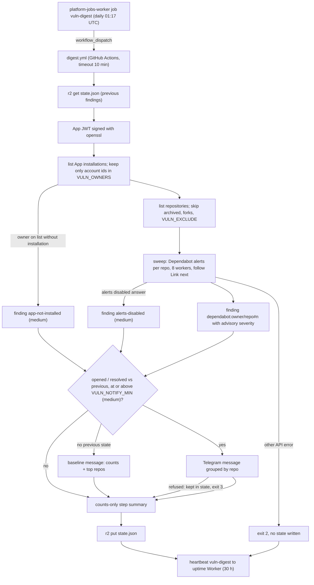
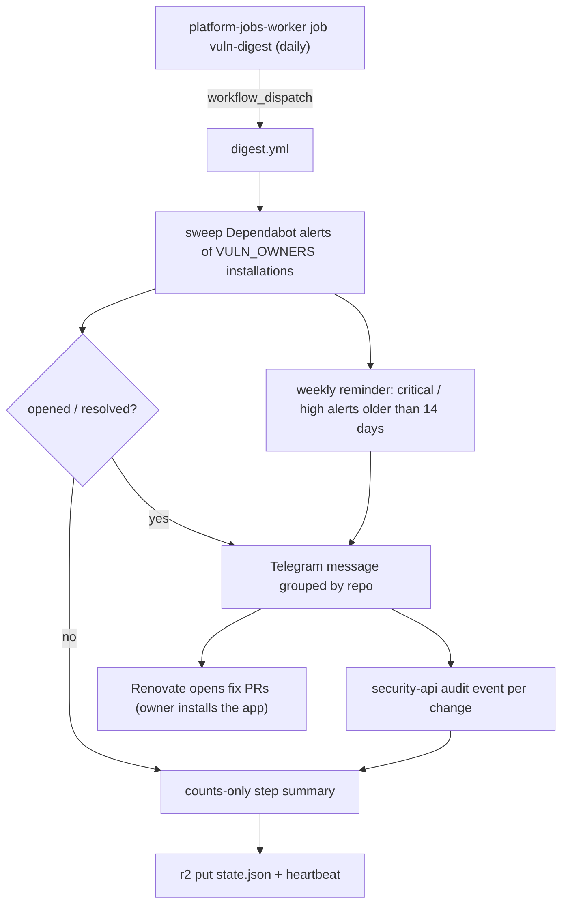

# 01 — Business process (As-Is / To-Be)

platform-vuln-digest คือ job รายวันที่อ่าน Dependabot alerts ที่เปิดอยู่ของทุก repository ของ owner ผ่าน GitHub App แบบอ่านอย่างเดียว เทียบกับรอบก่อน แล้วส่ง Telegram ให้ owner เฉพาะเมื่อมี alert เปิดหรือปิด หรือ repo ปิด alerts ไว้

Last reviewed: 2026-11-28 · commit `41f91f8`

## As-Is (จากโค้ดวันนี้)

Sources: `.github/workflows/digest.yml`, `vuln_digest/run.py` (`live_findings`, `run`, `main`), `vuln_digest/github.py` (`parse_owners`, `app_jwt`, `http`), `vuln_digest/checks.py` (`sweep`, `WORKERS = 8`), `vuln_digest/report.py`, `vuln_digest/r2.py`, `README.md`

ข้อเท็จจริงจากโค้ด: ไม่มีโค้ดส่ง audit event ไป `security-api` และไม่มี reminder รายสัปดาห์ (ค้นใน `vuln_digest/` ไม่พบ); Renovate ไม่ได้อยู่ใน repo นี้

## To-Be (`docs/specs/001-vuln-digest.md` status accepted, §Later; `docs/adr/ADR-0001-dependabot-alerts-and-app.md`)

Sources: `docs/specs/001-vuln-digest.md` §Outcome, §Requirements R1–R7, §Later

## Gap

| ID | As-Is → To-Be | Status | Owner | Evidence |
|---|---|---|---|---|
| G1 | ไม่มีการเตือนซ้ำ alert เก่า → reminder รายสัปดาห์ของ critical / high ที่ค้างเกิน 14 วัน | todo | claude | spec §Later; ไม่พบใน `vuln_digest/` |
| G2 | ไม่มี audit event ต่อการเปลี่ยนแปลง → `security-api` audit event ต่อ finding ที่เปิด / ปิด (แบบ posture-monitor) | todo | claude | spec §Scope "Out of scope for v1", §Later |
| G3 | digest รายงานอย่างเดียว ไม่มีใครเปิด fix PR → Renovate เปิด PR แก้ (owner ติดตั้ง app) | decide | owner | spec §Later; spec §Problem "Renovate is not installed" [ต้องยืนยัน] สถานะวันนี้ |

## Open questions

- ข้อ "Later" ใน spec ยังเป็นเป้าที่ owner ต้องการอยู่หรือไม่ (ยังไม่มีลำดับหรือวันที่)
- ทุก account ใน `VULN_OWNERS` ติดตั้ง App ครบแล้วหรือไม่ [ต้องยืนยัน] (ดูได้จาก finding `app-not-installed` ใน Telegram เท่านั้น)
